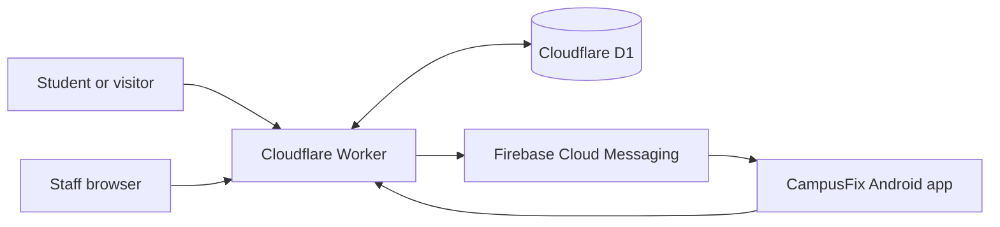

# CampusFix

CampusFix is a maintenance reporting system for Iloilo Science and Technology University. Students and campus visitors can scan a location QR code, report a problem without creating an account, and check its status with a tracking code. Maintenance staff review reports in a browser or the CampusFix Android app.

- [Live report form](https://campusfix.buildcurious.online/report)
- [Track a report](https://campusfix.buildcurious.online/track)
- [Staff sign-in](https://campusfix.buildcurious.online/staff/login)
- [Deployment and Android build guide](docs/DEPLOYMENT.md)

## What it does

- **Report an issue.** Location-specific QR codes preselect the campus location. Reporters can optionally drop a map pin for maintenance staff. The map opens at ISAT U Main Campus and uses OpenStreetMap tiles. The confirmation and staff dashboard show the same randomly generated six-character tracking code, such as `K7M2Q9`. Reporters can use it to check the current status. Staff can also search the dashboard by the internal reference, such as `CF-002`.
- **Manage the queue.** Staff can search, filter by reporting period or status, and dismiss spam, duplicates, or invalid reports with a reason. Staff can include an optional note with a status update. The reporter sees the note below the status on the tracking page. CSV exports use Philippine time.
- **Review analytics.** The staff Analytics tab charts reports received over time, current statuses, top categories, and top locations. Choose a reporting period and download the matching report CSV.
- **Share a photo.** Staff can attach one photo to a report. It appears below the status on the tracking page. The page shows when the current status was set and when the displayed photo was attached, in Philippine time. Staff can also copy the private photo link. CampusFix converts the photo to JPEG, with a maximum of 1,280 pixels on the longest side and 250 KB per report.
- **Attach an issue photo.** Reporters can take or choose a photo under **Description**. Staff can view it in the report details. A report can hold one issue photo and one staff reply photo, each compressed to a JPEG of up to 250 KB.
- **Get notified.** The staff dashboard shows new reports in its notification bell. Signed-in staff can also enable push alerts on Android and open reports directly from the alert.
- **Handle repeated submissions.** The Worker rate-limits reports, reuses the receipt for an identical submission retry, and flags possible duplicates. The live report form uses Cloudflare Turnstile.

## Run locally

Install **Node.js 22.12 or newer** with npm. Run these commands from the repository root in PowerShell.

```powershell
npm.cmd ci
npm.cmd run setup
npm.cmd run dev
```

On macOS or Linux, use `npm` in place of `npm.cmd`. Setup creates local staff credentials in `.dev.vars` on the first run and applies the D1 migrations. The default local username is `staff`. Read the generated `STAFF_PASSWORD` from your local `.dev.vars`. If you changed credentials in **Settings**, use the credentials you saved there.

| Page | Local URL |
| --- | --- |
| Submit a report | [http://127.0.0.1:8787/report](http://127.0.0.1:8787/report) |
| Track a report | [http://127.0.0.1:8787/track](http://127.0.0.1:8787/track) |
| Staff dashboard | [http://127.0.0.1:8787/staff](http://127.0.0.1:8787/staff) |
| Staff analytics | [http://127.0.0.1:8787/staff?view=analytics](http://127.0.0.1:8787/staff?view=analytics) |
| Campus location QR codes | [http://127.0.0.1:8787/staff/qr](http://127.0.0.1:8787/staff/qr) |

On Windows, you can also use [Start CampusFix.bat](Start%20CampusFix.bat) after setup. To populate a fresh local database with five sample reports, run `npm.cmd run db:seed`. Apply future local migrations with `npm.cmd run db:migrate`.

### Try the workflow

1. Open the report form and submit a test issue. Copy the tracking code on the confirmation.
2. Sign in as staff and find the report in the queue. Open it and update its status.
3. Paste the code on the tracking page and select **Check status**.
4. Open the **Location QR codes** page and choose **Open form** on a location card to try a report form with that location selected.

Campus locations and report categories are configured in [`src/catalog.js`](src/catalog.js).

To scan a local QR code from a phone, connect the phone and computer to the same network. Start Wrangler with `npm.cmd run dev -- --ip 0.0.0.0`, then open the app using the computer's LAN address before generating the QR code. The QR contains the hostname that served it.

## Architecture



The Worker serves the web interface and API. D1 stores reports, shared photos, status history, staff sessions, and delivery jobs. The Android app opens the staff dashboard in a WebView and uses Firebase Cloud Messaging for native report alerts.

| Path | Purpose |
| --- | --- |
| [`src/`](src/) | Worker routes, page templates, report protections, and push delivery |
| [`public/`](public/) | Browser JavaScript, styles, and branding assets |
| [`migrations/`](migrations/) | D1 schema migrations |
| [`scripts/`](scripts/) | Local setup and optional demo data |
| [`android/`](android/) | Android application and Gradle wrapper |

## Android app

The current Android build is **CampusFix 1.2.0**. The signed APK can be published separately as a GitHub Release asset.

The signed APK runs on Android 8.0 or newer. Push alerts require Google Play services. Install the APK provided by the project maintainer, sign in with your existing staff credentials, and allow notifications when prompted. Tapping an alert opens its report. [Firebase device requirements](https://firebase.google.com/docs/cloud-messaging/android/get-started)

See the [deployment and Android build guide](docs/DEPLOYMENT.md) for Cloudflare configuration, Firebase setup, and release signing.

## Developers

- Elmer S. Tumlos
- Ann Shaina C. Gilbao
- Jaynard M. Moralda
